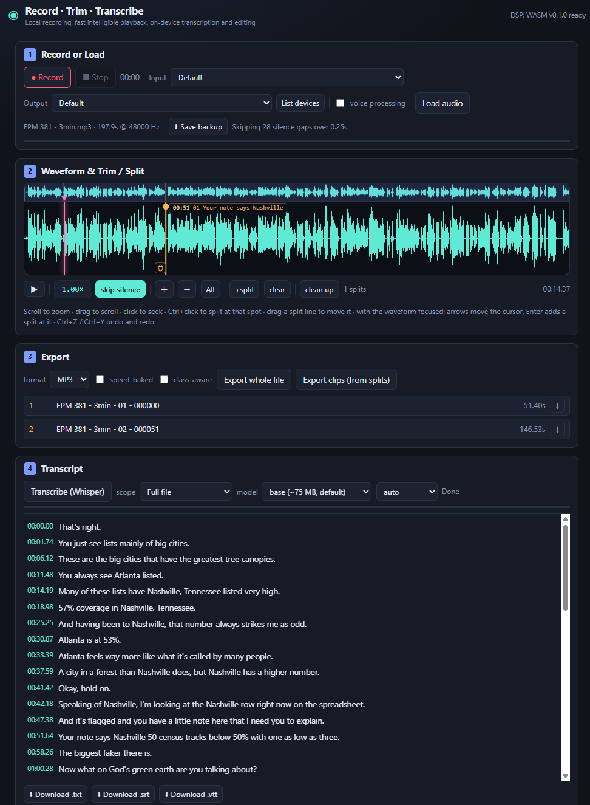

# Record � Trim � Transcribe

A local-first audio tool that runs entirely on your machine: record or load
audio, trim and split it, clean it up, play it back faster, transcribe it
on-device, and export the results. Nothing is uploaded.

**[Open the web app](https://luckymuck.github.io/RecordTrimTranscribe/)** � or
build the [portable desktop app](#portable) to use it with no network at all.



## Capabilities

1. **Record** audio.
2. **Load** local audio files.
3. **Playback** at 1.0ז4.0� while maximizing intelligibility by preserving consonant sounds.
4. **Clean up** with: rumble filter, RNNoise denoise, voice leveling, consonant boost, normalize, and peak limiter.
5. **Trim/Split** audio into separate clips.
6. **Transcribe** on-device with Whisper.
7. **Export/Save** as WAV or MP3.

## Recording

- **Devices** - **device settings** reveals the input and output pickers and asks
  for microphone permission, which browsers require before they will show device
  names. The pickers stay out of the way until the button is switched on.
- **Drag and drop** - drop an audio file anywhere on the page to load it. If
  something is already loaded or recorded, the drop asks before replacing it.
- **Loading a long file.** Before decoding, the duration and sample rate are read
  from the container and the memory cost is estimated against what this computer
  can plausibly give the app. If it does not fit, a **part panel** appears: choose
  a part length (15 min, 30 min or 1 hour) and a rate to keep (48, 24 or 16 kHz,
  which halves and quarters the cost), and load one part. Each part is a normal
  recording with its own 0-based timeline, clean-up, transcript and export.
- **How files are read.** A WAV is read as PCM directly, by byte range, so a
  six-hour file opens as a part without decoding the rest and without the 2 GB
  argument limit that `decodeAudioData` imposes. An **MP4/M4A/MOV or MKV/WebM**
  has only its audio track demuxed; the video is never read or decoded, which is
  what makes a 2 GB video with a 150 MB audio track cost almost nothing. Anything
  else goes through the browser's decoder and is trimmed to the range.
- **Recorded files** � the current clip is **autosaved to IndexedDB**; after any
  browser close a **recovery panel** lists everything saved on the device, each
  entry showing its name (the file's name, or the tentative `MMDDYYYY HHMM` of a
  recording), when it was last saved, its length and whether it was an
  interrupted recording. Load or discard each one, keep them for later, or
  discard all. Sessions older than seven days are removed automatically. Several
  browser tabs can be open at once: each writes its own session, so they never
  overwrite each other, and recovering one moves it to that tab's own record.
  Closing or leaving the page (Back, refresh) triggers a browser warning while an
  unsaved clip is loaded.

## Playback

- **Space** or the transport button toggles play/stop at the playhead.
- Change speed by click-dragging the speed readout left/right; double-click to
  reset. The range is 1.00ז4.00�; there is no slow-down.
- **Skip silence** skips any silence longer than 0.25 s, leaving a 0.2 s pause
  split evenly across the two edges of the gap so the words it separates are not
  clipped. The pause is measured at 1.00�, but is never below 0.1 s of output.
  Pauses shorter than the threshold are kept as-is.
- **Streaming (real-time).** `StreamStretcher` renders the buffered audio in
  short blocks using the *same* hybrid engine used offline (`engines::hybrid`),
  with a small look-behind so pitch marks and window ramps are fully established
  at every emit boundary, and a short crossfade across each seam.

## Editing

- **Ctrl+click**, **Enter**, or **[** on the waveform adds a split. Click the bin
  at the lower left of a split line, or right-click the line, to delete it.
- With the waveform focused: **arrows** nudge the cursor, **Home/End** jump to
  the ends, **Enter** splits at the cursor and **]** removes the nearest split.
- **Ctrl+Z** / **Ctrl+Y** undo and redo; on macOS **Cmd+Z** and **Cmd+Shift+Z**.
  Splits and clean-up steps are both undoable. Clean-up is non-destructive: the
  pristine source is kept, every run is rendered from it, and undo restores the
  previous settings, so repeated runs never stack and nothing is ever lost.
- **Clean up.** The `clean up` button opens a small options panel and a
  **Run clean-up** button; running it applies the selected stages to the
  recording before anything is stretched, because stretching exaggerates noise
  and breath, and then closes the panel. The stages are:
  - **rumble filter** � an 80 Hz high-pass that removes rumble, hum and handling
    noise (on by default).
  - **denoise** � [RNNoise](https://gitlab.xiph.org/xiph/rnnoise) speech
    denoising, run at 48 kHz in 10 ms frames and resampled back (on by default).
    Loaded from the vendored build under `app/vendor/rnnoise/`; there is no CDN
    fallback, so nothing can reach out. The model's state is reset for every run.
  - **level voices** � brings quiet passages up toward the loud ones, so a
    speaker further from the microphone is heard at about the same level as one
    close to it. Utterances are levelled one at a time: each is measured over its
    own speech and gets one gain, with the gain ramping across the pauses, so a
    quiet turn is lifted evenly from its first word to its last. The lift is
    capped (18 dB, and lower when the recording's own noise floor is close to its
    loud level) and a frame already near the loud level is not lifted with its
    passage, so a thump or click cannot be pushed up by a boost meant for the
    quiet speech around it.
  - **consonant boost** � a high-shelf above 2 kHz with a 0�6 dB strength control
    plus light high-band compression, so soft consonants sit closer to the vowels.
    The compressor's threshold comes from the band's own level, so the stage is a
    boost at every input level instead of turning into a cut on loud material.
  - **normalize** � sets the level, either to a -1 dBFS peak or to -20 dBFS RMS
    measured over the speech-active frames (pauses and transients excluded). The
    RMS mode only ever raises; the limiter handles the peaks.
  - **limit peaks** � a -1 dBFS lookahead limiter. It also runs automatically
    whenever a stage raised the level, and on any export whose peak would run
    over the ceiling, so cleaned audio cannot clip.
  - **apply to** � when the recording has splits, the clean-up can be applied to
    the whole file at once, to **each clip** on its own, or to one named clip.
    Per clip, every stage measures and acts on that clip alone � normalize over
    clip 1, then clip 2, and so on � which is what a clip exported on its own
    needs.

## Export

- **Offline bake.** `time_stretch()` renders the whole clip at a chosen speed
  with optional class-aware allocation. This powers the **"speed-baked"** export
  option: ticking that checkbox on the Export card renders exports through the
  DSP at the current playback speed.

## Transcripts

Transcripts can be generated for the whole file or for a single clip, and they
appear **as they are produced** rather than only at the end. Double-click a
transcript line to play the audio from that point.

Transcription reads the **pristine source** by default, with only a rumble
high-pass and the leveler applied: denoising and the consonant shelf are tuned
for listening and can remove detail the model uses, while Whisper is trained on
noisy audio and prefers it unshaped. Tick **cleaned audio** beside the Transcribe
button to send the cleaned render instead. A level change cannot move a
timestamp, so the word timings stay valid either way.

**Follow audio** (on by default) highlights the line being played and scrolls it
to sit four lines from the top, so you can read along with what was just said and
what is coming. The toggle is beside the Transcribe button.

**Focus** in the transcript header gives the transcript the page: the source and
export cards and the page header step out of the way, while the waveform and
transport stay so playback and follow-along still work. **Esc**, or the same
button, returns. The transcript box also has a drag handle for its height, and
the followed line is re-anchored after any resize.

**Reopening without re-transcribing.** Transcripts export as `.txt`, `.srt`,
`.vtt` and `.json`, named after the source so `<base>.srt` sits beside
`<base>.mp3`. Timestamps always refer to the unbaked source, so a speed or
silence-stripped audio export carries no matching suffix here. A transcript can
be loaded back with **Load transcript** (`.srt`, `.vtt`, `.txt` or `.json`) or by
dropping it on the page � dropping the audio and its transcript together pairs
them by name. A loaded transcript is marked *imported* until something is
transcribed in the session. The `.json` form round-trips exactly, word timings
included; SRT and VTT carry cue timings only, so they reload one chunk per cue.
**Save backup** embeds the transcript in the WAV, so that one file reloads audio
and transcript together: the chunk is a standard `LIST`/`INFO` comment that
players ignore, and it is stripped before decoding so it cannot affect how the
audio loads.

Speech that produced **no words at all** is marked `**` � a span of speech-shaped
energy the model did not turn into anything, which usually means it was not
intelligible. (Per-word confidence is not shown: the transcription library does
not expose it.)

**Repeated text is cleaned up.** Whisper can lock into a loop on music, noise or a
silence-heavy window and repeat one phrase or character. Three things run on every
transcription, always on: the decoder is given `no_repeat_ngram_size: 6`, so a
six-token sequence cannot appear twice in a window; a window with no speech is
skipped rather than sent to the model; and a window that still looks degenerate is
retried once with sampling, then collapsed. Collapsing keeps the first copy and
leaves a `**` over the dropped span, so a cut is visible rather than silent, and
the status line reports how many passages were collapsed and windows skipped. A
short repetition ("no, no") is left alone; only runs of four or more are treated
as a loop.

## Ways to run it

- **GitHub Pages** � the web app, at
  `https://luckymuck.github.io/RecordTrimTranscribe/`.
- **Website** � a static client (`app/`) served locally. All audio decoding, DSP,
  transcription and encoding run in the browser; nothing is uploaded.
- **Windows app** � the same `app/` assets wrapped in a Tauri shell that uses the
  built-in WebView2 runtime. No Python, Node or Rust needed to run it.

## Layout

The full file tree is in [LAYOUT.md](LAYOUT.md).

## Running the website

```powershell
python server.py            # or: start-website.bat
```

Then open the printed `http://127.0.0.1:8770/` address. A local server is required
because ES modules and WASM need HTTP (and a correct `application/wasm` MIME
type); `server.py` provides both.

On first transcription the Whisper weights (about 40 MB for tiny, 75 MB for base,
250 MB for small) are downloaded once from the Hugging Face Hub and cached by the
browser; the app warns before the first download.

## Running / building the desktop app

Prerequisites (build-time only): Rust, and the Tauri CLI (`cargo install tauri-cli`
or `npm i -D @tauri-apps/cli`). WebView2 is already present on Windows 10/11.

```powershell
# 1. Build the DSP core once
.\build-wasm.bat

# 2. Generate icons from a square PNG (one-time)
cd src-tauri
cargo tauri icon path\to\icon.png

# 3. Build the bundle
cargo tauri build
```

The bundle is written under `src-tauri/target/release/bundle/` (an NSIS
installer).

## Portable

`.\build-portable.bat` produces a self-contained folder and ZIP under `dist/`.
The app makes **no network requests at all**: the DSP, the MP3 encoder, RNNoise,
transformers.js and the ONNX Runtime wasm are all vendored under `app/vendor/`,
the three Whisper models are embedded in the executable, and the desktop CSP is
restricted to `'self'`.

```powershell
# once: download the three models into src-tauri/models (~360 MB)
.\src-tauri\fetch-models.bat

# build dist\portable\RecordTrimTranscribe\ and the ZIP
.\build-portable.bat
```

The executable is **235 MB** because the models are inside it (Tauri compresses
the embedded assets). Run it from any writable folder: no installation, no
registry entries, and no shortcuts. Everything the app saves � recordings,
sessions, settings and the model cache � lives in an `app-data` folder created
beside the executable (via Tauri's `appDirectoriesOverride`), so the whole folder
can be moved, copied to a USB stick, or deleted without leaving anything behind.
Windows 10 (April 2018+) and Windows 11 already include the WebView2 runtime the
app needs.

Both scripts need either Tauri CLI � `cargo install tauri-cli`, or
`npm i -D @tauri-apps/cli`, which `build-portable.bat` picks up automatically
through `npx`. The **first** build compiles the whole Tauri dependency tree and
takes roughly 25 minutes; later builds reuse it and take about three. The icon
set under `src-tauri/icons/` is committed, so `tauri icon` is only needed if you
want to replace it (`tauri icon src-tauri/app-icon.png`).

The models come from `onnx-community/whisper-{tiny,base,small}_timestamped` at
pinned revisions, and only the files that are actually loaded are fetched: the
config/tokenizer JSON and the two `q8` ONNX graphs. They are laid out the way
transformers.js expects for a local model, `<localModelPath>/<modelId>/<file>`,
and are served from `models/` inside the app. `src-tauri/models/` and `dist/` are
gitignored, so the repository stays small.

### Distributing the portable build

Attach the ZIP to a GitHub **Release** rather than committing it: Releases allow
files up to 2 GiB with no bandwidth limit, whereas Pages caps a site at 1 GB and
100 GB of bandwidth a month, and git would keep a 231 MB blob in history forever.
`dist/portable/SHA256SUMS.txt` holds the checksums of the executable and the ZIP,
so a download can be verified.

The executable is **not code-signed**, so Windows shows "Windows protected your
PC" the first time it runs and the user has to choose *More info ? Run anyway*.
Worth stating in the release notes as well as in the bundled `README.txt`. Code
signing would remove the prompt but needs a certificate.

## Known limitations

- **MP4 and MKV audio needs WebCodecs.** The demuxers read the sample tables
  themselves, but the compressed audio is decoded by the browser's own codec.
  Chromium, Edge and the desktop WebView2 have it, as does Firefox 130+; Safari's
  support is limited, so there such a file falls back to the browser's whole-file
  decoder and its 2 GB limit. MP4 audio covers AAC and Opus; MKV covers Opus, AAC
  and Vorbis; other codecs report that they are unsupported rather than failing
  obscurely.
- **Class-aware allocation is approximated.** FastTalk's headline feature
  allocates the speed budget per *phone class* using Montreal Forced Aligner
  output, which is not available in a browser. This port uses energy-based
  silence/speech segmentation (`rate::align_by_energy`) plus optional Whisper
  word boundaries. It is FastTalk's own degraded `Class::SPEECH` path, not the
  MFA path.
- On the web build, Whisper weights are a one-time download rather than bundled;
  the portable desktop build includes them.
- The pristine source is kept in memory as 16-bit PCM (half an f32 copy, about
  173 MB for 30 minutes or 346 MB for an hour at 48 kHz). Its quantization sits
  at about -96 dBFS, far below any recording's own noise floor, so it costs
  nothing audible and keeps transcription unaffected. A recording's original
  WebM chunks are left in place on disk rather than replaced by a snapshot of an
  edit, and a loaded file's pristine copy is re-read from the file handle.

## Verifying

```powershell
cd core
cargo test            # 77 tests: timing, pitch, PSOLA, WSOLA, streaming, rate,
                      # step continuity, real-time throughput, skip-silence,
                      # seam envelope, class-aware length, odd sample rates,
                      # rumble/consonant/level/normalize/limiter stages, the
                      # leveler's turn boundaries and transient guard, limiter THD
node dsp_smoke.mjs    # WASM bindings end-to-end (needs: npx wasm-pack build --target nodejs)

cd ..
node --test app/test/*.test.mjs   # 129 JS unit tests: WAV, MP4 and MKV reading,
                                  # resume labels, transcript parsing and
                                  # repetition repair, filenames, split
                                  # boundaries, dial and zoom arithmetic, WAV
                                  # encoding and the embedded transcript,
                                  # speech-active normalization, clean-up scopes,
                                  # the clean-up chain and RNNoise, transcript
                                  # follow/marker helpers, recovery labels
```

CI runs both suites (`.github/workflows/core-tests.yml`, `web-tests.yml`) plus a
check that the vendored WASM is present before Pages deploys.

## Licensing

This repository is distributed under the existing GPL-3.0 `LICENSE`. Its DSP
methods follow published WSOLA/MWSOLA and TD-PSOLA formulations, including
techniques from FastTalk's MIT-licensed implementation; those MIT-licensed
methods remain compatible with GPL-3.0.

The vendored RNNoise WebAssembly build (`app/vendor/rnnoise/`) is BSD-3-Clause
(Mozilla / Xiph.Org / Jean-Marc Valin / Mark Borgerding), also compatible with
GPL-3.0; see `app/vendor/rnnoise/COPYING`.

Other vendored third-party code, all compatible with GPL-3.0:

- `app/vendor/lamejs/` � the MP3 encoder, LGPL-3.0.
- `app/vendor/transformers/` � the transformers.js bundle (Apache-2.0) with
  ONNX Runtime Web inlined (MIT).
- `app/vendor/fasttalk-core/` � built from this repository's own `core/` crate.

The portable build ships `LICENSE` and `THIRD-PARTY-NOTICES.txt`, which lists
every bundled component with its licence text.
